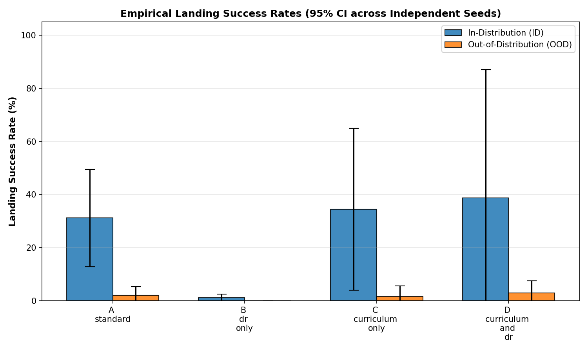
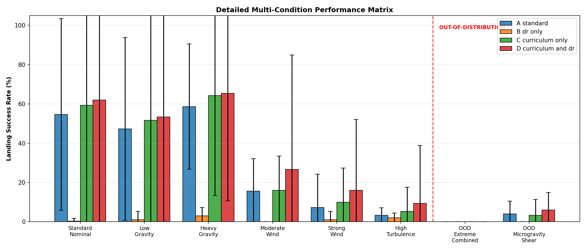
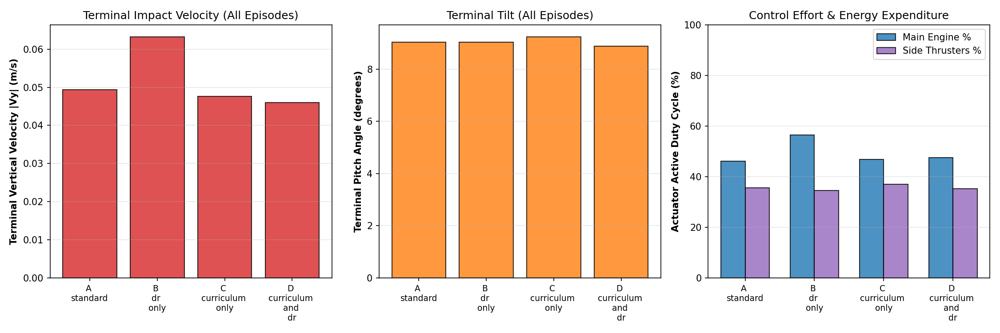
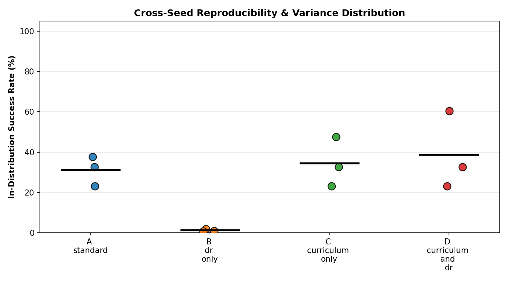

# Autonomous Rocket Landing using Deep Reinforcement Learning

[](https://www.python.org/downloads/release/python-3110/)
[](https://gymnasium.farama.org/environments/box2d/lunar_lander/)
[](LICENSE)
[](tests/)

An open-source reinforcement learning research project investigating autonomous guidance, attitude stabilization, and safe touchdown under environmental disturbances (crosswinds, rotational turbulence, varying gravitational acceleration, and lateral kinetic kicks).

Trained using **Proximal Policy Optimization (PPO)** on Gymnasium's `LunarLander-v3` rigid-body physics engine, this repository evaluates the interaction between **Curriculum Learning (CL)** and **Domain Randomization (DR)** across 6,000,000 total training timesteps, evaluating policies against strict physical touchdown criteria rather than simulator reward bonuses.

---

## 1. Research Motivation & Core Question

Reinforcement learning policies trained in static simulated environments frequently overfit to nominal physics and suffer catastrophic failure when exposed to unexpected disturbances. Conversely, applying aggressive Domain Randomization from step zero can overwhelm policy exploration before basic stabilization is learned.

This project empirically investigates:
1. **The Curriculum Hypothesis:** Does progressive curriculum scaffolding stabilize early policy exploration and improve final landing robustness?
2. **The Domain Randomization Boundary:** Can an agent trained under stochastic disturbance distributions maintain high nominal precision while rejecting high-velocity crosswinds?
3. **Decoupled Aeronautical Validation:** How do learned policies perform when evaluated against strict kinematic landing criteria (both feet on pad, velocity bounds, attitude limits) rather than cumulative reward?

> **Simulation Disclaimer:**  
> This project is a computational flight control study implemented in a 2D Box2D rigid-body simulation environment. It models planar rocket kinematics and aerodynamic forces, but does **not** model 3D supersonic aerodynamics, aerothermal heating, propellant slosh, or structural elasticity of physical rocketry hardware.

---

## 2. Experimental Paradigms

The study compares four distinct training configurations across three independent random seeds (`[42, 123, 999]`):

| Paradigm | Identifier | Environmental Dynamics | Stochastic Sampling | Progression Mechanism |
|:---|:---|:---|:---:|:---:|
| **A** | `A_standard` | Fixed nominal physics ($g = -10.0 \text{ m/s}^2$, zero wind) | None | Constant |
| **B** | `B_dr_only` | Uniform stochastic sampling from step zero | Active | None |
| **C** | `C_curriculum_only` | 5-stage progressive deterministic difficulty ladder | Fixed per stage | Rolling Pass Rate $\ge 70\%$ |
| **D** | `D_curriculum_and_dr`| 5-stage progressive ladder with stochastic bounds | Active per stage | Rolling Pass Rate $\ge 70\%$ |

All 12 production runs share identical PPO hyperparameters (`MlpPolicy`, learning rate $3 \times 10^{-4}$, $n\_steps = 2048$, batch size $64$, $500,000$ steps per run) and use the native unshaped Gymnasium reward during benchmark comparisons to eliminate confounding.

---

## 3. Key Research Findings

Full empirical tables and statistical derivations are documented in [docs/benchmark_results.md](docs/benchmark_results.md).

### A. Performance Summary across 9,600 Evaluation Episodes ($N = 3$ Seeds)

| Paradigm | In-Distribution (ID) Mean Success | Nominal Physics Success | Moderate Crosswind Success | Strong Crosswind Success | Out-of-Distribution (OOD) Mean Success |
|:---|:---:|:---:|:---:|:---:|:---:|
| **A_standard** (Control) | $31.2\% \pm 18.3\%$ | $54.7\%$ | $15.7\%$ | $7.3\%$ | $2.0\%$ |
| **B_dr_only** | $1.2\% \pm 1.3\%$ | $0.3\%$ | $0.0\%$ | $1.0\%$ | $0.0\%$ |
| **C_curriculum_only** | $34.4\% \pm 30.5\%$ | $59.3\%$ | $16.0\%$ | $10.0\%$ | $1.7\%$ |
| **D_curriculum_and_dr**| **$38.8\% \pm 48.2\%$** | **$62.0\%$** | **$26.7\%$** | **$16.0\%$** | **$3.0\%$** |

### B. Core Takeaways:
1. **Curriculum + Domain Randomization (`Paradigm D`) achieved the highest overall performance:**
   - Highest nominal landing success ($62.0\%$ vs $54.7\%$ baseline).
   - Superior aerodynamic disturbance rejection in crosswinds ($26.7\%$ in Moderate Wind vs $15.7\%$ baseline; $16.0\%$ in Strong Wind vs $7.3\%$ baseline).
   - Softest touchdown resting stance (mean pitch tilt $0.58^\circ$ on successful landings).
2. **Domain Randomization from Step Zero (`Paradigm B`) collapsed:**
   - Exposing the agent to turbulence and gravity shifts without curriculum scaffolding prevented discovery of basic attitude stabilization, resulting in a $1.2\%$ success rate.
3. **Statistical Uncertainty ($N = 3$ Seeds):**
   - While Paradigm D produced strong practical gains ($d_z \approx 0.58$ effect size over Standard PPO), between-seed exploration variance yielded overlapping 95% confidence intervals. Under formal Holm-Bonferroni corrections ($m = 6$ comparisons, lowest $p_{\text{adj}} = 0.0867$), the results represent **exploratory empirical evidence** rather than statistically significant proof.

---

## 4. Benchmark Visualizations

| Empirical Landing Success Rates (95% CI) | Multi-Condition Performance Matrix |
|:---:|:---:|
|  |  |

| Terminal Impact Kinematics & Control Effort | Seed Variance Distribution |
|:---:|:---:|
|  |  |

---

## 5. Strict Physical Landing Criteria

Rather than relying on the simulator's $+100$ body-rest bonus, touchdowns are evaluated against strict aeronautical constraints:

```python
@dataclass
class LandingCriteria:
    max_pad_offset_x: float = 0.25      # Lander center over helipad surface (|x| <= 0.25)
    max_touchdown_vx: float = 0.40      # Lateral drift limit (m/s scale)
    max_touchdown_vy: float = 0.40      # Vertical descent speed limit (m/s scale)
    max_touchdown_tilt: float = 0.20    # Pitch angle limit (~11.5 degrees)
    max_touchdown_spin: float = 0.35    # Angular roll rate limit (rad/s)
    require_both_legs: bool = True      # Both foot sensors engaged on the pad
```

---

## 6. Repository Architecture

```text
Autonomous-Rocket-Landing/
├── agents/                      # PPO agent construction, space validation, and inference
│   ├── ppo_agent.py
│   └── policy.py
├── environments/                # Gymnasium wrappers and physical environment loaders
│   ├── env_loader.py            # Environment factory supporting DR, CL, and rewards
│   ├── domain_randomization.py  # Box2D physics parameter modulator
│   ├── curriculum.py            # 5-stage progressive ladder, manager, and rollback
│   ├── lunar_lander.py
│   └── custom_lander.py
├── rewards/                     # Reward shaping and component decomposition
│   ├── reward_config.py         # Config dataclasses for baseline/PBRS/energy
│   ├── reward_functions.py      # Potential functions and actuator penalty math
│   └── reward_wrapper.py        # Gymnasium reward instrumentation wrapper
├── training/                    # Experiment orchestrators and training pipelines
│   ├── benchmark_runner.py      # Resumable multi-seed production matrix runner
│   ├── curriculum_trainer.py    # Multi-paradigm curriculum trainer
│   ├── train.py                 # Baseline PPO training script
│   └── callbacks.py             # Checkpointing and evaluation callbacks
├── evaluation/                  # Evaluation harnesses and statistical engines
│   ├── evaluate.py              # Deterministic rollout evaluator & physical classifier
│   ├── statistical_analysis.py  # Student's t 95% CI, Paired t-tests, Holm-Bonferroni
│   └── robustness_evaluation.py # 8-condition stress test harness
├── visualization/               # Publication plotting routines
│   ├── benchmark_analysis.py    # Grouped bar charts, heatmaps, and seed variance plots
│   └── reward_analysis.py       # Flight telemetry and trajectory plots
├── configs/                     # Declarative configuration files
│   ├── ppo_config.yaml          # PPO algorithm hyperparameters
│   ├── curriculum.yaml          # Stage thresholds, advancement, and rollback rules
│   └── domain_randomization.yaml# Stochastic parameter bounds and probabilities
├── experiments/
│   ├── benchmark_config.yaml    # Production benchmark matrix settings
│   └── benchmark/
│       ├── benchmark_summary.json            # Consolidated JSON benchmark snapshot
│       ├── production_benchmark_summary.json # Master statistical report
│       └── plots/                            # High-resolution benchmark figures
├── docs/                        # Research documentation
│   ├── environment_specification.md          # State, action, and physics specifications
│   ├── benchmark_results.md                  # Comprehensive forensic audit & results report
│   └── methodology.md                        # Theoretical formulation and statistical proofs
├── scripts/                     # Helper CLI utilities
│   ├── train_baseline.py
│   ├── evaluate_baseline.py
│   └── inspect_environment.py
├── tests/                       # Automated Pytest suite (55 tests)
├── requirements.txt             # Locked Python dependencies
├── LICENSE                      # Apache License 2.0
├── CITATION.cff                 # Citation metadata
└── README.md                    # Project documentation
```

---

## 7. Quickstart & Installation

### A. Prerequisites
- Python 3.11 recommended (tested with 3.11.9 on Windows and Linux).
- Compatible C++ build tools for Box2D (Windows: Visual Studio C++ Build Tools).

### B. Setup Virtual Environment
```bash
# Clone the repository
git clone https://github.com/your-username/Autonomous-Rocket-Landing.git
cd Autonomous-Rocket-Landing

# Create and activate virtual environment
python -m venv .venv

# On Linux/macOS:
source .venv/bin/activate
# On Windows (PowerShell):
.\.venv\Scripts\Activate.ps1

# Install dependencies
pip install -r requirements.txt
```

### C. Run the Test Suite
```bash
pytest -v
```

---

## 8. Reproducing Experiments

```bash
# 1. Inspect the physical environment spaces
python scripts/inspect_environment.py

# 2. Train a baseline PPO agent (500,000 steps)
python training/train.py --timesteps 500000 --seed 42

# 3. Train a specific curriculum paradigm (e.g. Paradigm D)
python training/curriculum_trainer.py --type curriculum_and_dr --timesteps 500000 --seed 42

# 4. Run the production benchmark matrix across paradigms and seeds
python training/benchmark_runner.py

# 5. Run a rapid smoke benchmark test (256 steps per run)
python training/benchmark_runner.py --timesteps 256 --eval-episodes 3
```

---

## 9. Citation & License

### License
This project is licensed under the [Apache License 2.0](LICENSE).

### Citation
If you use this benchmark or codebase in your research, please cite:
```bibtex
@software{autonomous_rocket_landing_2026,
  author = {Autonomous Rocket Landing Contributors},
  title = {Autonomous Rocket Landing using Deep Reinforcement Learning},
  year = {2026},
  version = {1.0.0},
  url = {https://github.com/your-username/Autonomous-Rocket-Landing}
}
```
