# Autonomous Rocket Landing using Deep Reinforcement Learning

[](https://www.python.org/)
[-brightgreen.svg)](https://gymnasium.farama.org/)
[](https://react.dev/)
[](https://threejs.org/)
[](tests/)
[](LICENSE)

An open-source deep reinforcement learning research platform and real-time aerospace flight-test workstation investigating autonomous rocket guidance, attitude stabilization, and pinpoint landing under aerodynamic disturbances.

The project pairs an authoritative **50 Hz Box2D physics simulation** with a trained **Proximal Policy Optimization (PPO)** agent, featuring a browser-based operations dashboard with dual **2D engineering** and **3D WebGL spaceport** visualization layers, real-time scientific telemetry, and experimental performance analytics across 9,600 evaluation episodes.

---

## 1. Project Visual Showcase

| Mission Briefing & Architectural Transparency | Autonomous 2D Canvas Flight Operations |
| :---: | :---: |
| 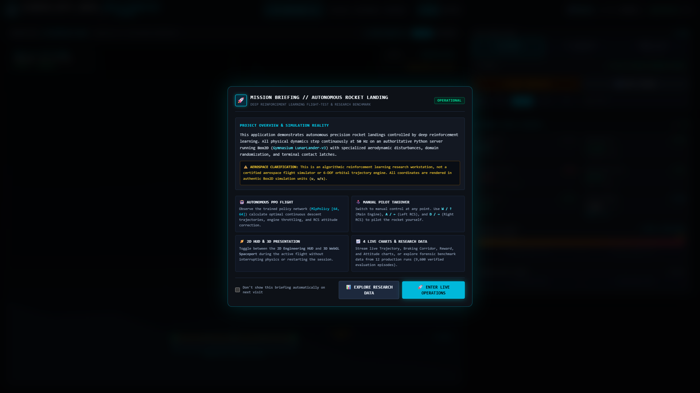 | 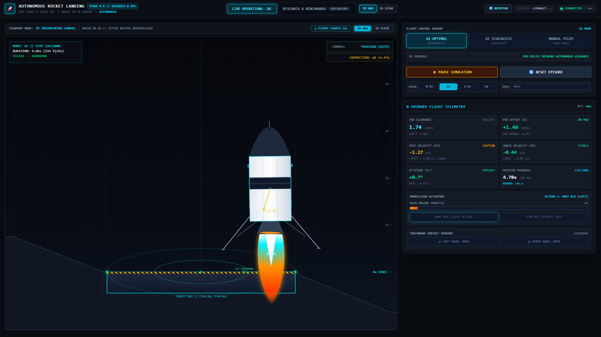 |

| 3D WebGL Spaceport Presentation Layer | Live Scientific Dynamics Charts |
| :---: | :---: |
| 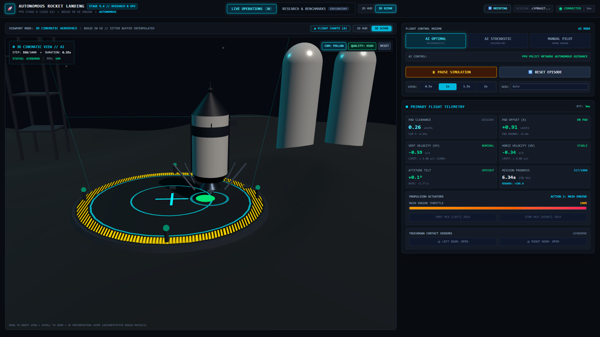 | 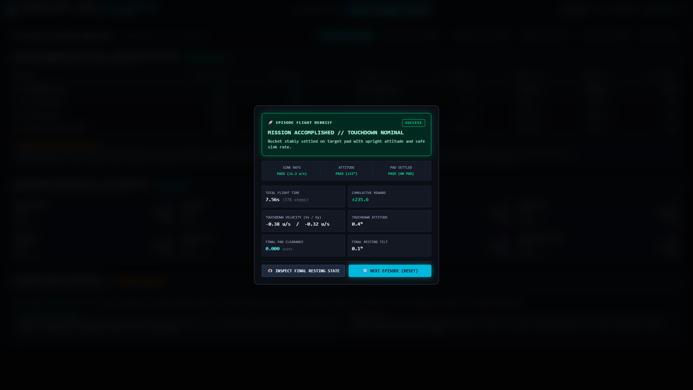 |

| Manual Fly-by-Wire Pilot Mode | Responsive Multi-Device Workstation |
| :---: | :---: |
| 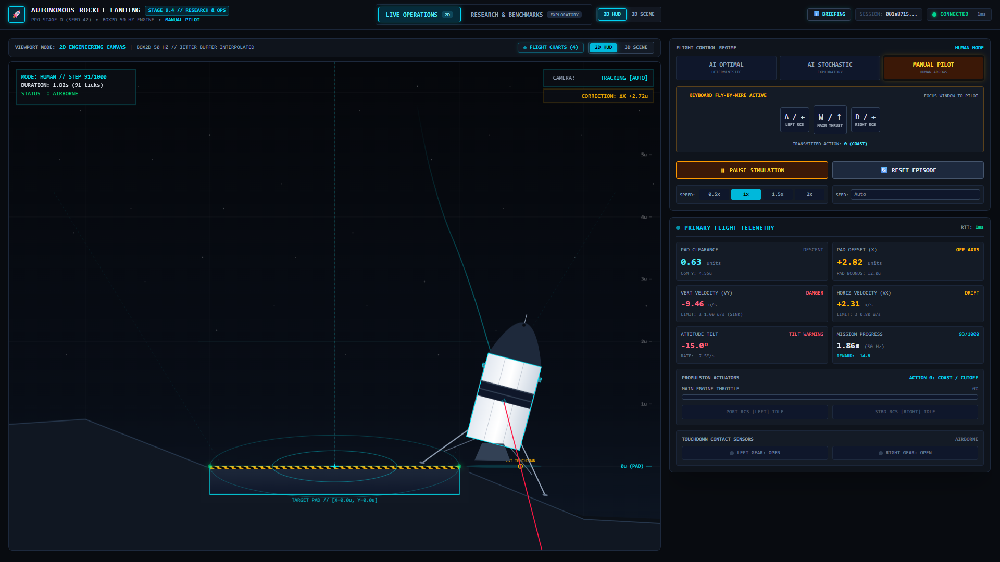 | 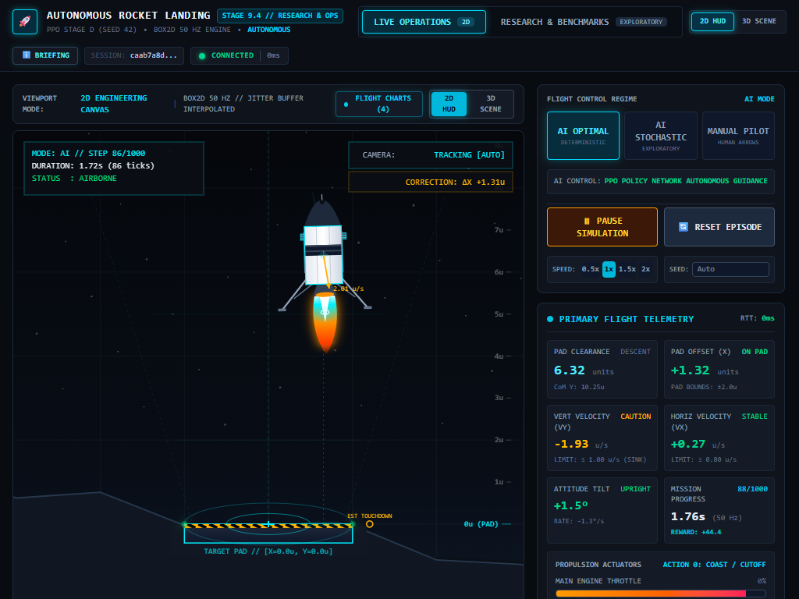 |

| 3D Realistic Rocket Design — Spaceport Braking Burn | 3D Realistic Rocket Design — Close-up Landing Pad |
| :---: | :---: |
| 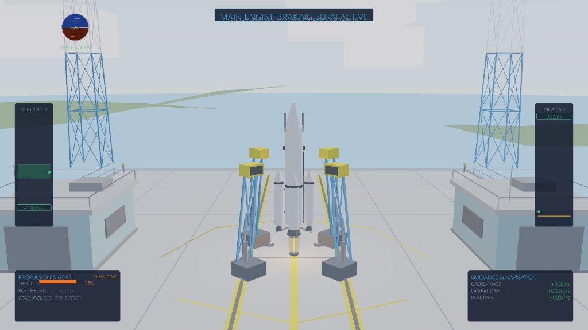 | 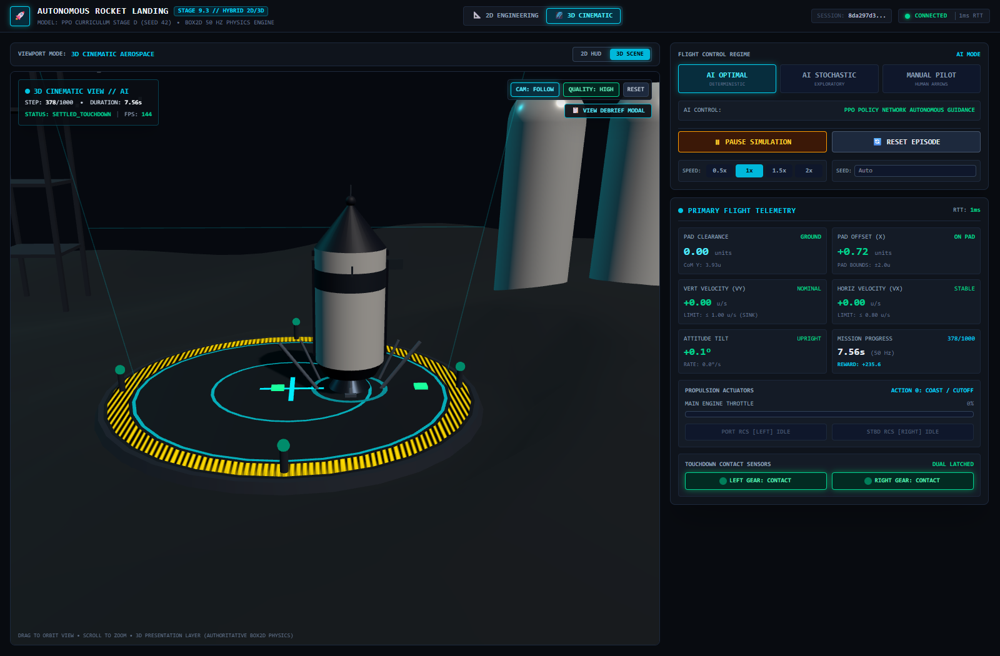 |

| 3D Realistic Rocket Design — Manual Pilot Engine Burn | 3D Live Operations — Follow Cam Descent |
| :---: | :---: |
| 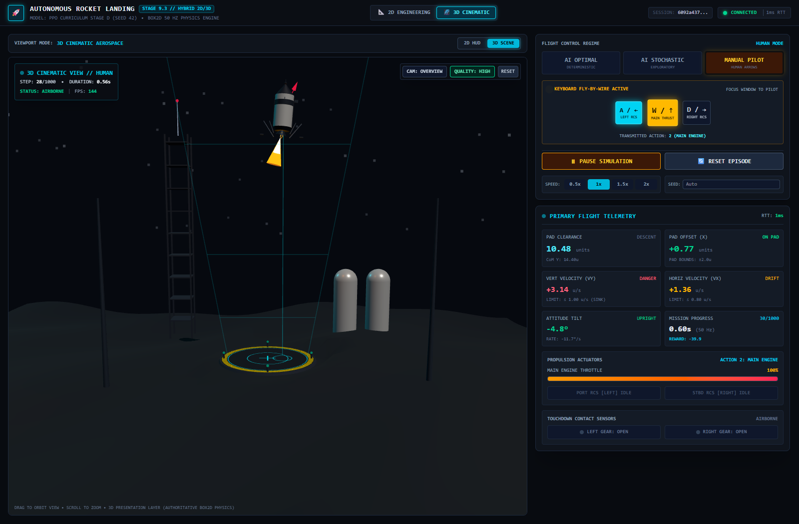 | 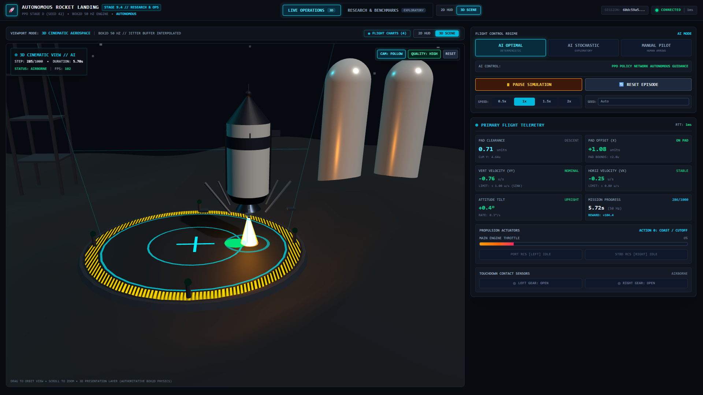 |

---

## 2. Technical Reality & Aerospace Clarification

To ensure scientific honesty and technical clarity:

- **Authoritative 2D Physics:** All physical dynamics, rigid-body collisions, gravity, aerodynamic drag, and contact latches step authoritatively at **50 Hz** ($\Delta t = 0.02\text{ s}$) inside a Python backend running Gymnasium `LunarLander-v3` with Box2D.
- **PPO Policy Execution:** Active guidance is commanded server-side by a PyTorch neural network trained with Stable-Baselines3 PPO.
- **3D Presentation Layer:** The 3D spaceport view is an orbital presentation layer powered by Three.js that maps 2D physical coordinates into a 3D visualization plane with procedural detailing, dynamic lighting, and particle effects. It does not introduce separate physics.
- **Aerospace Scope Disclaimer:** This is an algorithmic reinforcement learning research study, **not a certified aerospace flight simulator or 6-DOF orbital trajectory engine**. Coordinates are rendered in authentic Box2D simulation units (`u`, `u/s`), and discrete actions model thruster firing pulses rather than continuous vectoring gimbals.

---

## 3. System Architecture

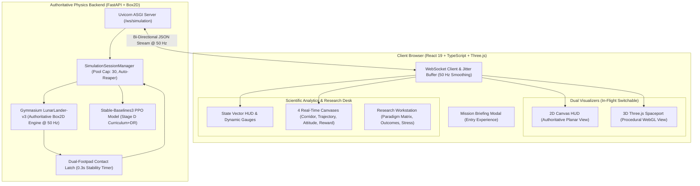

Detailed architectural specifications are documented in [docs/ARCHITECTURE.md](docs/ARCHITECTURE.md).

---

## 4. Reconciled Research Findings

The study investigated the interaction between **Curriculum Learning (CL)** and **Domain Randomization (DR)** across 12 production runs (4 paradigms $\times$ 3 matched seeds `[42, 123, 999]`), totaling **6,000,000 training steps** and **9,600 evaluation episodes** evaluated against strict physical touchdown criteria:

### A. Performance Summary across Evaluation Paradigms

| Paradigm | Identifier | Training Physics | Nominal Landing Success ($N=300$) | In-Distribution (ID) Mean ($N=1,800$) | Out-of-Distribution (OOD) Mean ($N=600$) | Mean Touchdown Tilt (Landings Only) |
| :--- | :--- | :--- | :---: | :---: | :---: | :---: |
| **A** | `A_standard` | Fixed nominal physics (Control) | $54.7\%$ [49.0%, 60.2%] | $31.2\% \pm 18.3\%$ | $2.0\% \pm 1.2\%$ | $0.75^\circ$ ($N=164$) |
| **B** | `B_dr_only` | DR from step zero (Uncurriculated) | $0.3\%$ [0.06%, 1.9%] | $1.2\% \pm 1.3\%$ | $0.0\% \pm 0.0\%$ | $0.06^\circ$ ($N=1$) |
| **C** | `C_curriculum_only` | Progressive 4-stage task ladder | $59.3\%$ [53.7%, 64.7%] | $34.4\% \pm 30.5\%$ | $1.7\% \pm 0.8\%$ | $0.87^\circ$ ($N=178$) |
| **D** | `D_curriculum_and_dr`| Progressive ladder + expanding DR | **$62.0\%$ [56.4%, 67.3%]** | **$38.8\% \pm 48.2\%$** | **$3.0\% \pm 1.4\%$** | **$0.58^\circ$ ($N=186$)** |

*Note: Ranges denote 95% Wilson score confidence intervals. Complete statistical derivations, Holm-Bonferroni correction tables, and sample-size caveats are documented in [docs/EXPERIMENT_RESULTS.md](docs/EXPERIMENT_RESULTS.md) and [STAGE_9_6_RESEARCH_RECONCILIATION.md](STAGE_9_6_RESEARCH_RECONCILIATION.md).*

### B. Core Research Insights:
1. **Curriculum + Domain Randomization (`Paradigm D`) produced the highest landing reliability:**
   - Achieved highest nominal landing success ($62.0\%$) and superior crosswind rejection ($26.7\%$ in Moderate Wind vs $15.7\%$ baseline).
   - Produced the most stable, upright touchdown stance ($0.58^\circ$ resting pitch tilt).
2. **Uncurriculated Domain Randomization (`Paradigm B`) suffered exploratory collapse:**
   - Applying environmental noise from step zero prevented the agent from learning basic vertical attitude stabilization, resulting in near-total failure ($0.3\%$ nominal success).
3. **Statistical Uncertainty ($N = 3$ Seeds):**
   - Evaluating 3 random seeds yields $df = 2$ degrees of freedom. Under Holm-Bonferroni corrections across all 6 pairwise comparisons, differences do not reach $p < 0.05$. Results are therefore presented as **exploratory empirical evidence**.

---

## 5. Quickstart & Installation

### Option 1: Run Locally (Python 3.11 + Node 20)

```bash
# 1. Clone the repository
git clone https://github.com/<ORG>/Autonomous-Rocket-Landing.git
cd Autonomous-Rocket-Landing

# 2. Set up Python virtual environment
python -m venv .venv

# On Linux / macOS:
source .venv/bin/activate
# On Windows PowerShell:
.\.venv\Scripts\Activate.ps1

# 3. Install Python dependencies
pip install --upgrade pip
pip install -r requirements.txt

# 4. Install and compile the frontend
cd web
npm ci
npm run build
cd ..

# 5. Start the backend simulation server
python -m uvicorn backend.app:app --host 127.0.0.1 --port 8000
```
Open **`http://127.0.0.1:8000`** in your browser.

### Option 2: Run via Docker

```bash
# Build production multi-stage container
docker build -t autonomous-rocket-landing .

# Run container on port 8080
docker run -p 8080:8080 autonomous-rocket-landing
```
Open **`http://localhost:8080`** in your browser.

---

## 6. Interactive Features & Controls

- **Autonomous PPO Flight:** Watch the trained reinforcement learning agent dynamically throttle the main descent engine and fire attitude thrusters to land inside the helipad target.
- **In-Flight 2D/3D Viewport Toggle:** Switch instantly between the 2D Canvas engineering HUD and the 3D WebGL spaceport during active flight without pausing or resetting physics.
- **Manual Fly-by-Wire Takeover:** Take manual control at any instant using keyboard keys:
  - `ArrowUp` or `W`: Fire Main Descent Engine.
  - `ArrowLeft` or `A`: Fire Right RCS Thruster (roll left).
  - `ArrowRight` or `D`: Fire Left RCS Thruster (roll right).
  - Switch back to `AI OPTIMAL` mode to allow the PPO policy to recover and land.
- **Live Scientific Telemetry:** Monitor dynamic velocity vectors, pad clearance, vertical speed indicator, and real-time state vectors.
- **Live Flight Dynamics Charts:** Stream live curves for braking corridor, trajectory ribbon, pitch attitude vs. roll rate, and cumulative reward.
- **Research Workstation:** Explore verified historical benchmarks, 4-paradigm performance comparisons, failure mode distributions, and environmental stress matrices across 9,600 evaluation episodes.

---

## 7. Automated Test Suites

The repository contains 205 automated tests verifying physics simulation, policy inference, WebSockets, rendering, and dashboard components:

```bash
# Run backend Pytest suite (138 tests)
pytest tests/

# Run frontend Vitest suite (67 tests)
npm test --prefix web -- --run
```

---

## 8. Project Documentation Directory

- [docs/ARCHITECTURE.md](docs/ARCHITECTURE.md): Detailed system architecture and WebSocket protocol.
- [docs/RESEARCH_METHODOLOGY.md](docs/RESEARCH_METHODOLOGY.md): Experimental paradigms, curriculum design, and landing criteria.
- [docs/EXPERIMENT_RESULTS.md](docs/EXPERIMENT_RESULTS.md): Full empirical evaluation tables and Holm-Bonferroni statistical tests.
- [docs/DEVELOPMENT.md](docs/DEVELOPMENT.md): Developer guide, local workflow, and testing runbook.
- [docs/DEPLOYMENT.md](docs/DEPLOYMENT.md): Containerization architecture and zero-cost hosting guide (Hugging Face Spaces / Render).
- [docs/LIMITATIONS.md](docs/LIMITATIONS.md): Technical modeling boundaries and future research scope.
- [STAGE_9_6_RESEARCH_RECONCILIATION.md](STAGE_9_6_RESEARCH_RECONCILIATION.md): Formal reconciliation of Paradigm D success rate figures.

---

## 9. License & Citation

This project is open-source software released under the [Apache License 2.0](LICENSE).

If you reference this research or implementation, please cite:

```bibtex
@software{autonomous_rocket_landing_2026,
  author = {Autonomous Rocket Landing Research Contributors},
  title = {Autonomous Rocket Landing using Deep Reinforcement Learning},
  year = {2026},
  url = {https://github.com/<ORG>/Autonomous-Rocket-Landing},
  license = {Apache-2.0}
}
```
