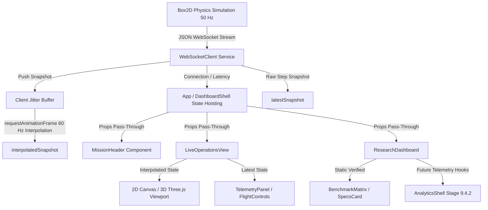

# Stage 9.4.1 — Research & Engineering Dashboard: Architecture Specification

**Project:** Autonomous Rocket Landing using Deep Reinforcement Learning  
**Milestone:** Stage 9.4.1 (Design & Architecture Foundation)  
**Status:** Approved & Formally Specified  
**Author:** Engineering & Research Team  

---

## 1. System Overview & Architectural Context

The Autonomous Rocket Landing system couples an authoritative Python/Gymnasium Box2D simulation engine with a high-performance web frontend. Stage 9.4 expands the hybrid 2D/3D flight-monitoring interface into a unified **Aerospace Research & Flight-Test Engineering Dashboard**.

The dashboard serves two core user personas:
1. **Aerospace / Robotics Flight Test Engineers:** Requiring instantaneous, deterministic telemetry readouts, physical coordinate mapping, control effort histories, and flight dynamics visualization.
2. **Reinforcement Learning Researchers:** Requiring empirical benchmark matrices across training paradigms (A/B/C/D), out-of-distribution (OOD) stress analysis, curriculum progression tracking, and model architecture provenance.

### Core Architectural Invariants:
- **Physics Authoritativeness:** Gymnasium `LunarLander-v3` running inside Box2D on the FastAPI backend remains the sole authoritative physics engine. Timestep is strictly $0.02$ seconds ($50\text{ Hz}$).
- **Non-Disruptive State Hoisting:** Navigating between operational flight monitoring (`LIVE OPERATIONS`) and empirical evaluation (`RESEARCH & BENCHMARKS`) **never** resets, interrupts, or reconnects the live simulation session. The WebSocket client, jitter buffer, and simulation lifecycle remain continuously active at the top-level application shell.
- **Zero Fabrication Policy:** All benchmark figures, performance tables, and model specifications represent verified forensic audit results from `docs/benchmark_results.md`. Analytical charts planned for Stage 9.4.2 display disciplined, clearly labeled "Awaiting telemetry data" empty states. No fake curves or synthetic waveforms are rendered.

---

## 2. Reconnaissance Findings: Capabilities & Data Availability

### 2.1 Backend Protocol & Telemetry Snapshot Schema
The authoritative WebSocket snapshot (`SimulationSnapshotPayload`) transmits at $50\text{ Hz}$ across the `/ws/simulation` endpoint:

| Telemetry Subsystem | Backend Fields | Physical Meaning / Units |
|:---|:---|:---|
| **Kinematics 2D** | `pos_x`, `pos_y` | Box2D coordinates ($1.0\text{ u} = 10.0\text{ m}$). Pad center at $X=0.0$, pad surface at $Y=0.0$. |
| | `vel_x`, `vel_y` | Linear velocities in $\text{u/s}$ (scale to $10.0\text{ m/s}$). |
| | `angle`, `ang_vel` | Attitude angle $\theta$ ($\text{rad}$) and rate $\dot{\theta}$ ($\text{rad/s}$). Zero is upright. |
| | `altitude` | Footpad ground clearance ($Y_{\text{clearance}} = \text{pos\_y} - 1.083\text{u}$). |
| **Propulsion State** | `action` | Discrete action $[0, 1, 2, 3]$ (Coast, Left RCS, Main Engine, Right RCS). |
| | `throttle` | Main engine thrust fraction $[0.0, 1.0]$. |
| | `rcs_left`, `rcs_right` | RCS vernier nozzle firing states (boolean). |
| **Landing Gear** | `left_contact`, `right_contact` | Microswitch contact sensors on footpads engaging the ground. |
| **Atmosphere** | `wind_force`, `turbulence` | Real-time lateral wind disturbance vector and rotational gust torque. |
| **Lifecycle & Return**| `step`, `sim_time` | Timestep counter and physical elapsed mission time ($t = \text{step} \times 0.02\text{s}$). |
| | `step_reward`, `cumulative_reward`| Instantaneous reward and cumulative episode return $R = \sum r_t$. |
| | `touchdown_phase` | Enum: `AIRBORNE`, `TERMINAL_APPROACH`, `TOUCHDOWN_DETECTED`. |
| | `terminated`, `truncated`, `outcome` | Terminal status and verified outcome (`SUCCESS`, `CRASH`, `TIMEOUT`). |

### 2.2 Forensic Benchmark Data
The research repository holds verified experimental records from $12$ production training runs across $4$ paradigms ($6,000,000$ steps, $9,600$ evaluation rollouts, $8$ environmental conditions):
- **Paradigm A (Standard PPO):** Baseline on nominal physics ($54.7\%$ nominal success, $31.2\%$ ID mean).
- **Paradigm B (DR Only):** Direct domain randomization without scaffolding ($0.3\%$ nominal success, $1.2\%$ ID mean).
- **Paradigm C (Curriculum Only):** 4-stage task progression ($59.3\%$ nominal success, $34.5\%$ ID mean).
- **Paradigm D (Curriculum + DR):** Dual developmental curriculum ($62.0\%$ nominal success, $38.8\%$ ID mean, $0.58^\circ$ mean resting tilt).

---

## 3. Information Architecture & Navigation Hierarchy

The dashboard divides into two primary workspaces accessible via high-density top-level navigation:

```
┌────────────────────────────────────────────────────────────────────────────────────────┐
│ MISSION HEADER / COMMAND BAR: Title | View Tabs (LIVE / RESEARCH) | 2D/3D Toggle | WebSocket Status │
├────────────────────────────────────────────────────────────────────────────────────────┤
│                                                                                        │
│  [MODE: LIVE OPERATIONS]                              [MODE: RESEARCH & BENCHMARKS]    │
│  ┌──────────────────────┬──────────────────────┐      ┌──────────────────────────────┐ │
│  │ 1. VISUALIZATION     │ 2. SIDEBAR PANELS    │      │ SUB-TABS:                    │ │
│  │    VIEWPORT          │    - Flight Controls │      │  [PARADIGMS] [SPECS] [LOGS]  │ │
│  │    - 2D Canvas HUD   │    - Real-Time       │      ├──────────────────────────────┤ │
│  │    - 3D Three.js     │      Telemetry Read  │      │ - Empirical Paradigm Matrix  │ │
│  │      Spaceport Scene │      (Alt, Vel, Rate)│      │ - Environmental Stress Suite │ │
│  │                      │    - Contact Sensors │      │ - Model & Box2D Spec Cards   │ │
│  │                      │    - Atmospheric Wind│      │ - Stage 9.4.2 Analytics Shell│ │
│  └──────────────────────┴──────────────────────┘      └──────────────────────────────┘ │
└────────────────────────────────────────────────────────────────────────────────────────┘
```

### 3.1 Live Flight Operations Workspace
- **Primary Viewport (8 Columns Desktop):** Displays either the 2D Canvas HUD (vector guidance, reticle, velocity vectors, target markers) or the 3D Three.js WebGL spaceport (procedural booster, lighting, particle exhaust, dynamic cameras).
- **Sidebar Flight Deck (4 Columns Desktop):**
  - `FlightControls`: Flight mode selector (AI Autonomous vs Manual Pilot), Policy toggle (Deterministic vs Stochastic), Playback rate, Pause/Resume, Reset, and keyboard throttle triggers.
  - `TelemetryPanel`: Digital tabular readouts for altitude, descent rate, lateral velocity, body attitude, angular velocity, throttle level, wind velocity, and contact states.

### 3.2 Research & Experiment Benchmarks Workspace
- **Sub-Tab 1: Paradigm Benchmarks (`BenchmarkMatrix`):** Side-by-side empirical performance table comparing Paradigms A, B, C, D across Nominal Success, ID Mean Success, Resting Tilt ($N=1$ caveat for Paradigm B), Terminal Kinematics, and Engine Duty cycles.
- **Sub-Tab 2: System Specifications (`ExperimentContextCard`):** PPO hyperparameter table, Box2D environment parameter bounds, discrete action spaces, continuous observation encoding, and physical touchdown criteria ($v_x, v_y \le 0.40\text{ m/s}$, $|\theta| \le 0.20\text{ rad}$, both legs engaged).
- **Sub-Tab 3: Flight Analytics Shell (`AnalyticsShell`):** High-density empty-state shells defining the layout, axes, and telemetry units for Stage 9.4.2 charts (Trajectory Profile $Y(X)$, Descent Velocity Envelope $v_y(Y)$, Reward Progression $R(t)$, Attitude Stabilization $\theta(t)$, and Session Episode Table).

---

## 4. Component Hierarchy & Modular Architecture

The frontend component tree is organized into reusable atomic primitives, container shells, and domain viewports:

```
web/src/
├── components/
│   ├── common/
│   │   ├── TelemetryReadout.tsx     // High-density numeric readout with tabular figures & status tokens
│   │   ├── StatusBadge.tsx          // Aerospace semantic badge with pulse & glow options
│   │   ├── PanelContainer.tsx       // Standard aerospace panel chrome with title, badge & action slot
│   │   ├── TabNavigation.tsx        // Keyboard-accessible ARIA tablist / tab switcher
│   │   ├── DataGrid.tsx             // Multi-column key-value metrics grid
│   │   ├── StateVectorDisplay.tsx   // Coordinate-aware formatted vector component display
│   │   └── EmptyState.tsx           // Disciplined aerospace placeholder for awaiting telemetry
│   │
│   ├── dashboard/
│   │   ├── DashboardShell.tsx       // Top-level layout manager & primary view switcher
│   │   ├── MissionHeader.tsx        // Unified mission command bar with live WebSocket & latency
│   │   ├── LiveOperationsView.tsx   // Dual-column layout for 2D/3D viewport + telemetry sidebar
│   │   ├── ResearchDashboard.tsx    // Research workstation hosting benchmark sub-tabs
│   │   ├── BenchmarkMatrix.tsx      // Verified empirical comparison table & caveat callouts
│   │   ├── ExperimentContextCard.tsx// Model architecture & Box2D environment specifications
│   │   └── AnalyticsShell.tsx       // Structured telemetry chart & episode log shell
│   │
│   ├── SimulationCanvas.tsx         // Authoritative 2D Canvas engineering renderer
│   ├── ThreeSimulationViewport.tsx  // Code-split Three.js 3D WebGL renderer
│   ├── FlightControls.tsx           // Mission controls & manual action dispatcher
│   ├── TelemetryPanel.tsx           // Real-time telemetry readouts panel
│   └── EpisodeDebriefModal.tsx      // Post-landing / crash debrief analysis modal
│
├── services/
│   ├── websocketClient.ts           // Reconnecting WebSocket client with telemetry latency tracking
│   └── jitterBuffer.ts              // Client-side snapshot interpolation & timestamp ordering
```

---

## 5. State Management & Data Flow Architecture

The data flow enforces single-direction telemetry propagation from the authoritative backend through the client-side jitter buffer into the presentation components:



### State Hoisting Guarantees:
1. `wsClientRef` and `jitterBufferRef` reside strictly at the root level of `App.tsx`.
2. When the user switches `activeDashboardTab` from `operations` to `research`:
   - The WebSocket connection remains open.
   - Incoming $50\text{ Hz}$ snapshots continue to be pushed into the jitter buffer.
   - No teardown, disconnect, or reconnection packets are transmitted to FastAPI.
3. When the user switches back to `operations`:
   - The active viewport immediately resumes rendering the live vehicle position with zero reload lag.

---

## 6. Technical Debt & Constraints Addressed

1. **Monolithic App Deconstruction:** The previous `App.tsx` mixed WebSocket protocol logic, 2D/3D toggle handling, sidebar layout, debrief modal management, and header formatting in a single $392$-line file. Stage 9.4.1 extracted the visual hierarchy into `DashboardShell`, `MissionHeader`, and `LiveOperationsView`, leaving `App.tsx` strictly as a clean coordinator.
2. **Tabular Numerics Enforcement:** Telemetry fluctuations previously caused slight layout shifts as numbers varied in digit width. All telemetry primitives now enforce `font-variant-numeric: tabular-nums` and fixed-width monospaced formatting.
3. **No Decorative SaaS Aesthetics:** Rounded bubbly cards, neon purple gradients, arbitrary speedometer gauges, and ungrounded waveforms have been completely avoided in favor of restrained aerospace instrument chrome.
