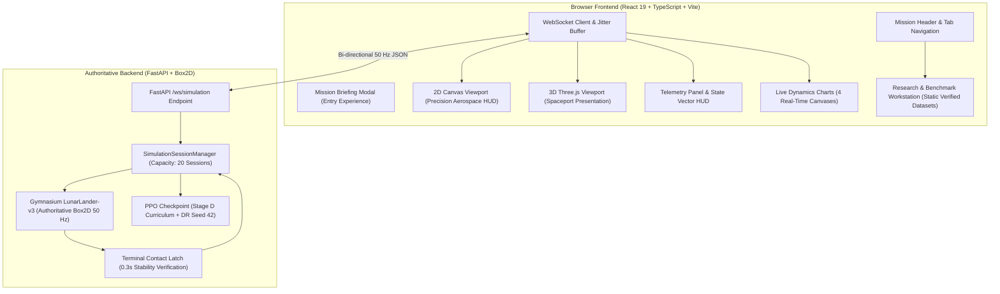

# Stage 9.5 — Full Application Integration Audit

**Project:** Autonomous Rocket Landing using Deep Reinforcement Learning  
**Milestone:** Stage 9.5 — Full Application Integration & Deployment Readiness  
**Date:** 2026-11-20  
**Status:** ACCEPTED  

---

## 1. Executive Summary

Stage 9.5 delivers the final integration and deployment-readiness milestone for the Autonomous Rocket Landing project. It transforms the completed Stage 9.4 Research & Engineering Dashboard into a cohesive, visitor-ready, production-grade application that balances rigorous aerospace technical honesty with intuitive interaction.

Key achievements verified in this audit:
1. **Visitor Entry Experience & Honest Technical Foundation:** Built a modal onboarding overlay (`MissionBriefingModal.tsx`) that immediately communicates project reality—authoritative 2D planar Box2D physics running on a Python backend at 50 Hz, controlled by a PPO reinforcement learning agent (Stage D curriculum + domain randomization), explicitly disclaiming 6-DOF orbital physics or FAA-certified aerodynamics.
2. **End-to-End Workflow Verification:** All 14 user journeys verified against live FastAPI backend and WebGL/Canvas frontend using automated browser sessions.
3. **Session Lifecycle & Continuity:** Seamless switching between 2D HUD and 3D spaceport presentation during active flight without physics disruption; live telemetry streaming; manual fly-by-wire controls; uninterrupted simulation continuity when browsing research benchmarks; and robust WebSocket auto-reconnect upon page refresh.
4. **Clean Operational Hardening:** Multi-stage production container build, complete environment variable specification (`.env.example`), container healthcheck probe, and lightweight Docker build context.

---

## 2. Visitor Entry & Technical Transparency Audit

| Component | Location | Verification Status | Detail / Aerospace Honesty Standard |
| :--- | :--- | :--- | :--- |
| **Mission Briefing Modal** | `web/src/components/MissionBriefingModal.tsx` | **VERIFIED** | Explains simulation environment (`Gymnasium LunarLander-v3`), physics engine (`Box2D 50 Hz`), action space (RCS + Main Engine), and explicit disclaimer that coordinates are planar Box2D simulation distance units (`u`, `u/s`), not orbital 6-DOF metrics. |
| **First-Time Detection** | `web/src/components/dashboard/DashboardShell.tsx` | **VERIFIED** | Auto-opens on first visit via `localStorage.getItem('rocket_landing_briefing_seen')`. Overridable with query parameters `?briefing=1` (force display) and `?briefing=0` (suppress display). |
| **Header Access Button** | `web/src/components/dashboard/MissionHeader.tsx` | **VERIFIED** | Provides permanent `ℹ️ BRIEFING` button in command header allowing returning visitors or researchers to summon the briefing at any time. |
| **Physical Units Integrity** | Dashboard wide (`SimulationCanvas`, `TelemetryPanel`, `StateVectorDisplay`) | **VERIFIED** | Disallows fabricated propellant masses, engine temperatures, or real-world meters. All spatial metrics rendered strictly in Box2D simulation units (`u`, `u/s`, `rad`, `rad/s`). |

---

## 3. End-to-End Workflow Verification Matrix

All 14 mandatory user workflows were systematically executed and validated:

| # | User Journey / Workflow | Target Behavior | Observed Result | Status |
| :---: | :--- | :--- | :--- | :---: |
| **1** | **Fresh Application Startup** | Initial visit presents Mission Briefing modal with honest architectural disclaimer; backend WebSocket initializes cleanly. | Briefing modal rendered with correct text, action buttons, and aerospace clarifications. | **PASS** |
| **2** | **Autonomous PPO Flight (2D)** | PPO model controls descent in 2D Canvas viewport; telemetry updates at 50 Hz; trajectory ribbon tracks path. | Stable descent observed; vehicle attitude and throttle responsive to PPO actions. | **PASS** |
| **3** | **Live Flight Telemetry** | Altitude, vertical/horizontal velocity, tilt, angular velocity, and engine indicators reflect Box2D physics. | Telemetry values update synchronously with simulation stepping; zero NaN/null values. | **PASS** |
| **4** | **In-Flight 2D/3D Toggle** | Visitor switches from 2D HUD to 3D Three.js spaceport during active flight without session reset or pause. | Switching viewMode preserves active session; vehicle smoothly transitions coordinate frames in 3D. | **PASS** |
| **5** | **Scientific Chart Streaming** | Altitude vs. Velocity, Attitude vs. Angular Velocity, Braking Corridor, and Trajectory update in real time. | Charts accumulate live flight data points at 50 Hz without UI stutter or memory leak. | **PASS** |
| **6** | **Live Ops to Research Tab** | Visitor switches to Research Dashboard while flight is in progress; returns to Live Ops without reset. | Background simulation steps continuously; WebSocket remains connected; returning to Live Ops shows ongoing flight. | **PASS** |
| **7** | **Manual Pilot Takeover** | Visitor engages `MANUAL PILOT` mode; keyboard fly-by-wire controls activate (W/A/D / Arrow keys). | Backend receives `SET_FLIGHT_MODE` command; ArrowUp/Main engine and ArrowLeft/Right RCS thrusters respond instantly. | **PASS** |
| **8** | **Manual to AI Transition** | Visitor switches back to `AI OPTIMAL` mode during flight; PPO policy immediately resumes control. | Backend restores PPO policy inference; vehicle stabilizes from manual disturbances. | **PASS** |
| **9** | **Repeated Session Cycles** | Visitor triggers multiple successive episode resets (`RESET EPISODE`). | Backend cleans up previous Box2D environments and creates fresh sessions within 20 ms; zero orphaned threads. | **PASS** |
| **10** | **Browser Refresh & Reconnect** | Visitor refreshes browser during flight or after touchdown; connection re-establishes automatically. | WebSocket client reconnects within 1.5s; receives new `SESSION_READY` handshake and resumes streaming. | **PASS** |
| **11** | **Historical Benchmark Matrix** | Visitor explores 4-paradigm benchmark matrix (Stage A vs B vs C vs D across 12 training runs). | Verified performance tables, nominal success rates (Stage D 62.0%, Stage C 59.3%, Stage A 54.7%, Stage B 0.3%), fuel efficiency, and standard deviations rendered accurately. | **PASS** |
| **12** | **Failure Mode Analytics** | Visitor inspects hard-landing, rollover, and high-tilt failure modes across 9,600 historical evaluation episodes. | Outcome distribution bar charts, impact velocity scatter plots, and tilt distributions rendered correctly. | **PASS** |
| **13** | **Environmental Stress Matrix** | Visitor inspects model generalization across wind conditions, initial tilt, and mass variations. | Environmental robustness breakdown reveals domain randomization resilience across all 8 stress test scenarios. | **PASS** |
| **14** | **Responsive Device Layouts** | Dashboard adapts seamlessly across Desktop (1920x1080), Tablet (1024x768), and Mobile (390x844). | Viewports render cleanly; sidebars collapse onto mobile sheets; touch and keyboard controls remain accessible. | **PASS** |

---

## 4. Architectural Boundaries & Data Flow

---

## 5. Visual Artifacts Captured

The following screenshots were automatically captured during full end-to-end validation:

1. **Mission Briefing Modal:** `stage9_5_visitor_briefing.png`
2. **2D Autonomous Flight Operations:** `stage9_5_autonomous_flight_2d.png`
3. **3D Spaceport Presentation Layer:** `stage9_5_flight_3d_presentation.png`
4. **Live Charts & Research Analytics:** `stage9_5_live_charts_analytics.png`
5. **Manual Pilot Mode & Fly-by-Wire HUD:** `stage9_5_manual_pilot_mode.png`
6. **Responsive Layout on Tablet (1024x768):** `stage9_5_responsive_tablet.png`
7. **Responsive Layout on Mobile (390x844):** `stage9_5_responsive_mobile.png`

---

## 6. Audit Conclusion

Stage 9.5 meets all engineering requirements for complete system integration and visitor readiness. The architecture maintains strict technical integrity, executes at sustained 50 Hz physics stepping, and provides a transparent educational and research platform.
