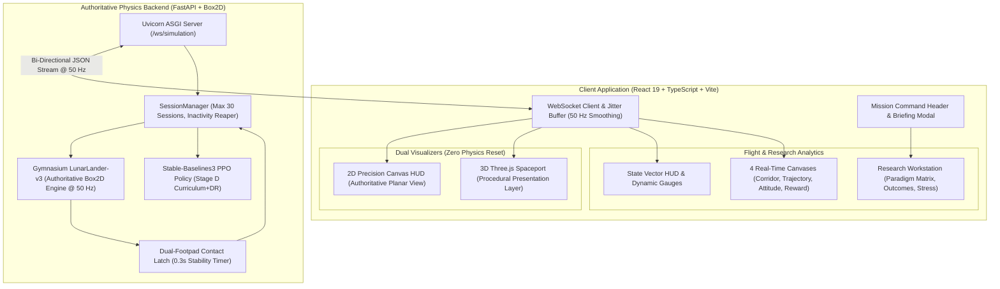

# System Architecture & Technical Specifications

**Project:** Autonomous Rocket Landing using Deep Reinforcement Learning  
**Milestone:** Stage 9.6  
**License:** Apache License 2.0  

---

## 1. Architectural Philosophy

The system decouples **authoritative physical simulation** from **graphical presentation and analytics**. Physical state transitions and reinforcement learning policy inference are strictly executed server-side at **50 Hz** in Python. The client-side browser application serves purely as a real-time observation, control, and experimental analytics workstation.

---

## 2. Server-Side Physical Simulation Engine

- **Physics Engine:** Box2D planar rigid-body physics via Gymnasium `LunarLander-v3`.
- **Stepping Rate:** Fixed time step $\Delta t = 0.02\text{ s}$ ($50.0\text{ Hz}$).
- **State Vector ($8\text{ dimensions}$):**
  1. $x$: Horizontal displacement from pad center (simulation units).
  2. $y$: Vertical altitude from surface level (simulation units).
  3. $v_x$: Horizontal linear velocity (units/sec).
  4. $v_y$: Vertical descent velocity (units/sec).
  5. $\theta$: Pitch orientation angle (radians; $0 = \text{vertical}$, counter-clockwise positive).
  6. $\dot{\theta}$: Angular velocity / spin rate (rad/s).
  7. $c_{\text{left}}$: Left landing leg contact sensor ($0.0$ or $1.0$).
  8. $c_{\text{right}}$: Right landing leg contact sensor ($0.0$ or $1.0$).
- **Action Space ($4\text{ discrete actions}$):**
  - `0`: Coast / Engine Idle.
  - `1`: Left Reaction Control System (RCS) thruster.
  - `2`: Main descent engine throttle.
  - `3`: Right Reaction Control System (RCS) thruster.
- **Terminal Contact Latch:**
  - Evaluates true dual-leg contact ($c_{\text{left}} = 1.0 \land c_{\text{right}} = 1.0 \land |x| \le 0.25$).
  - Implements a $0.3\text{ second}$ ($15\text{ frames}$) contact stability timer to confirm the vehicle has stabilized before declaring successful touchdown.

---

## 3. Communication Protocol (WebSocket Stream)

- **Endpoint:** `/ws/simulation`
- **Transport:** Persistent bi-directional JSON WebSocket frames.
- **Handshake Sequence:**
  1. Client initiates connection.
  2. Server returns `SESSION_READY` payload containing `sessionId`, initial physical snapshot, and environment capabilities.
  3. Server transmits `SIMULATION_SNAPSHOT` frames at $50\text{ Hz}$ containing kinematics, engine state, lifecycle, and impact dynamics.
- **Client Commands:**
  - `CONTROL_CMD`: `pause`, `resume`, `reset`, `set_speed`.
  - `SET_FLIGHT_MODE`: `ai` (deterministic / stochastic) or `human` (fly-by-wire).
  - `STEP_ACTION`: Action indices `0` through `3` dispatched during manual pilot mode.

---

## 4. Frontend Dual-Viewport Presentation Layer

### 4.1 2D Canvas Engineering Viewport
- Dark aerospace HUD style rendering.
- Exact planar Box2D coordinates projected with aspect ratio preservation.
- Displays flight path ribbon, contact sensor indicators, dynamic velocity vectors, landing pad clearance markers, and wind shear vectors.

### 4.2 3D WebGL Spaceport Presentation Viewport
- Powered by Three.js with hardware-accelerated WebGL.
- Maps 2D planar physics into a 3D coordinate frame ($x_{3D} = x_{2D}, y_{3D} = y_{2D}, z_{3D} = 0$). Depth is utilized solely for visual atmosphere, volumetric terrain, and procedural booster detailing.
- **Procedural Booster Model:**
  - Interstage ring, avionics bay, grid fins, main engine gimbal bell, and dual articulating landing legs.
  - Landing legs automatically deploy as altitude drops below $1.5\text{ units}$.
  - Custom GLSL shader exhaust plumes and dynamic particle smoke trails.
- **Zero-Reset Synchronization:** Visitors can switch between 2D and 3D at any instant during active flight; both renderers subscribe to the same underlying state buffer.

---

## 5. Research & Engineering Workstation

Integrated into the client application via clean tabbed navigation:
- **Live Operations View:** Real-time dual viewport, state vector HUD, dynamic vertical speed indicator, and manual fly-by-wire controls.
- **Flight Dynamics Tab:** 4 real-time Canvas charts plotting altitude vs. velocity (braking corridor), pitch angle vs. angular rate, trajectory coordinates, and reward progression.
- **Paradigm Matrix Tab:** 4-paradigm performance comparisons (A vs B vs C vs D) across 12 training runs and 9,600 evaluation episodes.
- **Outcomes & Failure Modes Tab:** Bar charts and scatter distributions classifying touchdowns, rollovers, hard impacts, and trajectory timeouts.
- **Environmental Stress Tab:** Generalization robustness under varying gravity ($-4.5$ to $-15.0\text{ m/s}^2$), lateral crosswinds ($0$ to $30\text{ m/s}$), and turbulence.
- **Provenance & Methodology Tab:** Hypothesis tests, Holm-Bonferroni correction tables, Wilson score confidence intervals, and dataset checksums.
